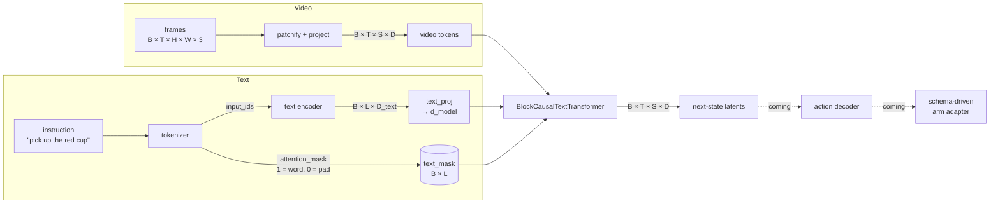
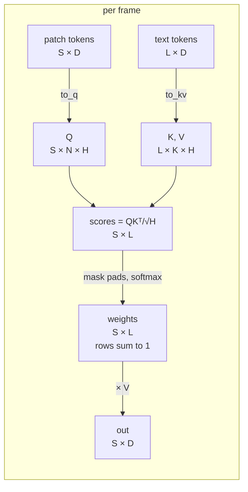
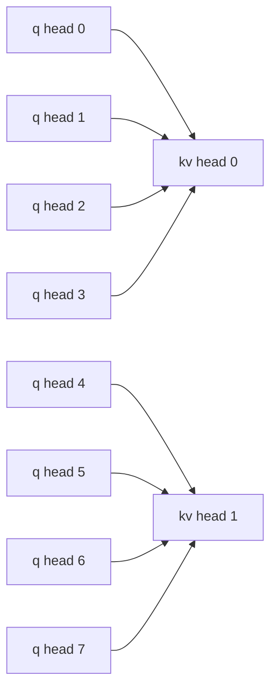
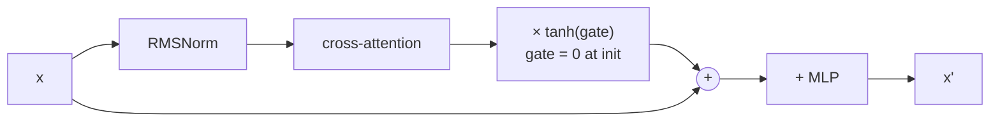
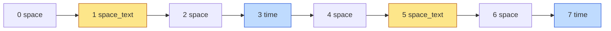
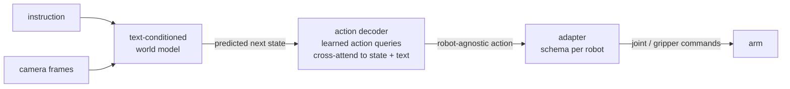

# Text conditioning: how the world model reads an instruction

This is my writeup of how I added text conditioning to the block-causal video
transformer. The goal is a model that takes an instruction ("pick up the red cup")
plus video and predicts what happens next. Later, an action decoder will turn that
prediction into robot commands (see [Where this is going](#where-this-is-going)).

Code: [`dreamer/models.py`](../dreamer/models.py), classes `GroupedCrossAttention`,
`SpaceTextCrossAttention`, `BlockCausalTextLayer`, `BlockCausalTextTransformer`.
Tests: [`tests/test_text_conditioning.py`](../tests/test_text_conditioning.py).
Each design decision is tagged `REVIEW ITEM <n>` in the code; the numbers below
match.

---

## 1. The big picture



Shapes used throughout:

| Symbol | Meaning |
|---|---|
| B | batch size |
| T | frames |
| S | tokens per frame (latents + patches) |
| L | text tokens |
| D | model width (`d_model`) |
| N / K | query heads / key-value heads |
| H | width of one head = D / N |
| G | query heads per kv head = N / K |

---

## 2. Cross-attention: who asks, who answers

Attention always has a side that **asks** (queries, Q) and a side that **answers**
(keys K and values V). The output has **one vector per query**.

* **Q from text, K/V from video** → output is `(L, D)`, one vector per word. The text
  reads the image. Useful when you want to update the text (e.g. a captioner, or
  later: learned action queries reading the scene).
* **Q from video, K/V from text** → output is `(S, D)`, one vector per patch. Each
  patch reads the instruction. This is what conditioning needs, because the result
  has to be added back into the video's residual stream. **(REVIEW ITEM 1)**



**S and L never need to match.** The score matrix is S × L: every patch is compared
with every word. The only thing that must agree is the per-head width H, since Q
and K are dot-producted. My first attempt zero-padded the text so L == S; that was
unnecessary and harmful, because unmasked zero keys still receive softmax weight.
**(REVIEW ITEM 8)**

### Matching the batch dimension (REVIEW ITEM 7)

Space attention folds frames into the batch: `(B, T, S, D) → (B·T, S, D)`. The
text is `(B, L, D)`, so it's copied once per frame, `(B, L, D) → (B·T, L, D)`, and
**the mask is copied the same way**. Every frame of a clip follows the same
instruction.

### Grouped-query attention (REVIEW ITEM 2)

GQA uses fewer K/V heads than query heads to save memory. With N = 8, K = 2, each
kv head is shared by G = 4 query heads:



`jax.nn.dot_product_attention` does this grouping itself: pass q as `(B, S, N, H)`
and k, v as `(B, L, K, H)`, and query head n reads kv head n // G. Q has to be
split into **N heads of width H**. My original reshape split it into G groups, and
G·H = D/K ≠ D, so einops raised.

### No RoPE, no cache (REVIEW ITEMs 3, 5)

* **RoPE** encodes relative position along one shared axis. Patches and words don't
  share one, so it's skipped. Word order is already inside the text embeddings.
* **KV cache** exists so causal attention doesn't recompute past frames. The text
  doesn't change during a rollout, so its K/V can be computed once and reused;
  appending to a cache every step would be wrong.

---

## 3. Masks: padding is not causal (REVIEW ITEM 4)

Text in a batch is padded to a common length. The tokenizer returns
`attention_mask` to say which positions are real. The name is misleading: the
tokenizer computes no attention, it only marks padding.

```
"pick up cup"            → [BOS pick up  cup   EOS  PAD PAD]   mask [1 1 1 1 1 0 0]
"open the drawer slowly" → [BOS open the drawer slowly EOS PAD] mask [1 1 1 1 1 1 0]
```

| | padding mask | causal mask |
|---|---|---|
| shape | `(B, L)`, per sample | `(L, L)`, same for all |
| rule | ignore pad positions | token i can't see tokens after i |
| comes from | the data | the model design |
| used in cross-attention? | **yes** | **no**, patches may see every word |

In code: `(B·T, L) → (B·T, 1, 1, L)`, which broadcasts over heads and queries.
JAX takes a **boolean** mask (True = attend) and inserts the −∞ itself.

Every sample needs at least one real token (BOS counts). An all-pad row has no
valid keys, and the output is NaN or meaningless. **(REVIEW ITEM 17)**

---

## 4. The layer: three kinds (REVIEW ITEMs 11, 14)

Every layer is pre-norm: `x = x + attn(norm(x))`, then `x = x + mlp(x)`. What
changes is the attention:

| kind | attends over | mask | cache |
|---|---|---|---|
| `space` | other patches in the same frame | `space_mask` | no |
| `space_text` | the instruction's words | `text_mask` | no |
| `time` | the same patch position in past frames | causal + window | yes |

My first version turned *every* space layer into cross-attention, which removed
patch-to-patch mixing altogether. Keeping three explicit kinds keeps both.

### Text norm (REVIEW ITEM 12)

Pre-norm only normalizes the video stream. The text comes from a different network
with its own scale, so each `space_text` layer gets its own RMSNorm on the text
before projecting it to K/V.

### The tanh gate (REVIEW ITEM 13)



The gate starts at 0, so at initialization the layer is **exactly** a no-op. This
does two things:

1. A pretrained video model isn't disrupted by randomly initialized
   cross-attention: training starts from the same function.
2. The model opens the gate only as fast as the text proves useful.

The gradient still flows: d(loss)/d(gate) is nonzero at step 0, while the
cross-attention weights get exactly zero gradient until the gate moves. Tests that
check "every parameter learns" must account for that, which is why
`test_transformer_without_gate_uses_text_and_trains_everything` turns the gate off.
(Flamingo uses the same trick.)

---

## 5. The transformer: the schedule (REVIEW ITEMs 15, 16)

The time-layer rule is the same as `BlockCausalTransformer`'s, so time layers sit at
the same depths. Among the remaining slots, every `text_every`-th becomes
`space_text`. With the defaults and depth 8:



Read the frame → read the instruction → mix the two within the frame → look across
time. You can override this with `layer_schedule=(...)`; a schedule with no
`space_text` layer is rejected, because the text would be silently ignored.

The text encoder's width (`text_dim`) doesn't have to match the video `d_model`.
The transformer projects text to `d_model` **once** and shares it across all
`space_text` layers; with matching widths the projection is skipped.

### Cost (REVIEW ITEM 18)

Per frame, a space layer costs ∝ S², a space_text layer ∝ S·L. With ~10 words
against hundreds of patches, cross-attention is cheap.
`estimate_attention_flops(..., seq_text=L)` counts it.

---

## 6. Bugs worth remembering

| REVIEW ITEM | Bug | Lesson |
|---|---|---|
| 1 | Q from text | output length = query length; decide who asks |
| 2 | reshape into G groups | Q is split into N heads; the library does the grouping |
| — (old code) | batch check fell back to self-attention silently | fail loudly, never fall back silently |
| 8 | zero-padding L to S | unmasked zeros still get attention weight |
| 9 | args shifted by one under `remat` | positional args + `static_argnums` are fragile; test them |
| 10 | dataclass instance as a default | use `field(default_factory=...)` |

Each of these is caught by a behavioral test, not by reading the code: output
shape, "different text → different output", "garbage in pad slots → same output",
"every parameter gets gradient".

---

## Where this is going



* **Action decoder:** a few learned *action query* tokens cross-attend to the
  predicted state and the text. This is the case where Q comes from something other
  than the patches (section 2).
* **Schema-driven adapter:** maps the decoder's action into a specific robot's
  controls (joints, gripper, limits) from a declarative schema, so one model can
  drive different arms.

Open item: `TextEncoder` still calls the plain `BlockCausalTransformer` and needs to
be rewired to `BlockCausalTextTransformer` (REVIEW ITEM 19).
